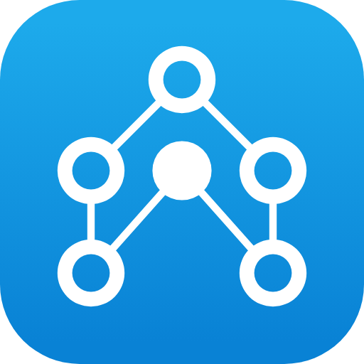

# Archboard plugin

Archboard is a hosted diagram workspace for architecture, Kubernetes, C4, flowcharts, ER diagrams, mind maps and boards.
This repository connects AI apps to the Archboard MCP server, so an assistant can read, create and edit diagrams on the
same live canvas your team uses. Every node has a type from a node pack, so the result stays a structured diagram that
people keep editing, not a static picture.

- **MCP server:** `https://getarchboard.app/mcp` (remote, Streamable HTTP, OAuth 2.1)
- **Docs:** [getarchboard.app/docs/mcp](https://getarchboard.app/docs/mcp) · setup guides per app:
  [getarchboard.app/integrations](https://getarchboard.app/integrations)
- **MCP Registry name:** `app.getarchboard/archboard`

This repository holds configuration files, one skill written in Markdown, and images. It contains no code and runs
nothing on your computer.

## Install

Each line is one step. The first time a tool is used, the app opens the Archboard sign-in in your browser (see
[Sign-in and access](#sign-in-and-access)). If you already added Archboard from your app's connector directory, there is
no need to add it again here.

| App | Install |
|---|---|
| Claude (web, desktop, mobile) | [Add custom connector](https://claude.ai/customize/connectors?modal=add-custom-connector&connectorName=Archboard&connectorUrl=https%3A%2F%2Fgetarchboard.app%2Fmcp) (Customize → Connectors, URL `https://getarchboard.app/mcp`) |
| Claude Code (plugin with skill) | `claude plugin install archboard --marketplace getarchboard/archboard-plugin`, then `/mcp` → `plugin:archboard:archboard` to sign in |
| Claude and Cowork (plugin with skill) | Customize → Plugins → Add marketplace `getarchboard/archboard-plugin`, then connect Archboard from the plugin's Connectors tab |
| Claude Code (server only) | `claude mcp add --transport http --scope user archboard https://getarchboard.app/mcp`, then `claude mcp login archboard` |
| Cursor | [Add to Cursor](https://cursor.com/en/install-mcp?name=archboard&config=eyJ1cmwiOiJodHRwczovL2dldGFyY2hib2FyZC5hcHAvbWNwIn0%3D) |
| VS Code | `code --add-mcp '{"name":"archboard","type":"http","url":"https://getarchboard.app/mcp"}'` |
| Gemini CLI (extension) | `gemini extensions install https://github.com/getarchboard/archboard-plugin` |
| Antigravity (plugin with skill) | `agy plugin install https://github.com/getarchboard/archboard-plugin`, then Customizations → Installed → Archboard → MCP → Authenticate |
| Codex (0.147.0 or later) | `codex mcp add archboard --url https://getarchboard.app/mcp` |
| GitHub Copilot CLI | `copilot mcp add --transport http archboard https://getarchboard.app/mcp` |
| Grok (web) | [grok.com/connectors](https://grok.com/connectors) → New Connector → Custom, URL `https://getarchboard.app/mcp` |
| Grok Build | `grok mcp add --transport http archboard https://getarchboard.app/mcp` |
| Kiro | [Add to Kiro](https://kiro.dev/launch/mcp/add?name=archboard&config=%7B%22url%22%3A%22https%3A%2F%2Fgetarchboard.app%2Fmcp%22%7D) |
| Other MCP apps | Remote server URL `https://getarchboard.app/mcp`, transport Streamable HTTP, OAuth sign-in |

Manifests in this repository, by app:

| Path | Used by |
|---|---|
| `.claude-plugin/plugin.json`, `.claude-plugin/marketplace.json`, `.mcp.json` | Claude Code and Claude plugins |
| `.cursor-plugin/plugin.json`, `mcp.json` | Cursor |
| `.antigravity-plugin/plugin.json`, `mcp.json` | Antigravity |
| `gemini-extension.json` | Gemini CLI |
| `chatgpt/` | ChatGPT and Codex plugin package |
| `skills/archboard-diagramming/SKILL.md` | Skill: the Archboard diagramming guide |
| `server.json` | MCP Registry entry |

## Sign-in and access

- Sign-in uses OAuth 2.1 (authorization code with PKCE). Apps register with a Client ID Metadata Document or dynamic
  client registration. People sign in to Archboard with Google or GitHub.
- On the consent screen you choose which organizations and workspaces the app can reach, and whether it may read, edit
  or delete there. Deleting moves a diagram to the trash, where it can be restored.
- You can change or remove an app's access at any time under **Settings → Connected apps** in Archboard. Removing it
  disconnects the app right away.
- The app's cursor on the canvas is labeled with the app's name and the person it acts for.

## Example prompts

1. `Create a new Archboard diagram called "Checkout service" showing a web app, an API gateway, an orders service, a payments service and a Postgres database, with labeled connections.`
2. `Turn this Mermaid flowchart into an Archboard diagram: flowchart LR; Signup --> Verify{Email verified?}; Verify -->|yes| Onboarding; Verify -->|no| Reminder`
3. `List my Archboard diagrams and summarize the most recently updated one.`
4. `In the "Checkout service" diagram, add a Redis cache between the orders service and the database, then show me a snapshot.`
5. `Export the "Checkout service" diagram as an SVG and give me the download link.`

## Tools

| Tool | What it does | Changes data |
|---|---|---|
| `read_me` | Usage guide: workflow, document format, layout rules, limits and error codes | No |
| `list_workspaces` | Organizations and workspaces this connection can use, with role, plan and permission | No |
| `list_diagrams` | Diagrams this connection can access, newest first, with their permission | No |
| `create_diagram` | Create a new diagram in a workspace | Yes |
| `get_canvas` | Read a diagram: an outline, or full records page by page | No |
| `search_node_types` | Find node types across packs (Kubernetes, cloud, C4, BPMN, mind map and more) | No |
| `get_node_type` | Size, props, style keys and ports of one node type | No |
| `apply_ops` | Add, change or remove nodes, connections and images as one revertible change | Yes, can remove |
| `compose_diagram` | Draw a Mermaid flowchart or an infographic spec as one revertible change | Yes |
| `add_image` | Add an image from a public https URL; Archboard's server downloads it once | Yes |
| `upload_image` | One-time upload link for a local image file (apps that can run shell commands) | Yes |
| `render_snapshot` | PNG render of the diagram or a part of it, for checking the result | No |
| `export_diagram` | PNG or SVG export with a download link (15 minutes, up to 5 downloads) | No |
| `get_selection` | What the person has selected in their open editor | No |
| `set_status` | Short status next to the app's cursor on the canvas | No (presence only) |
| `revert_change` | Undo one change this app made in the last 7 days | Yes |
| `delete_diagram` | Move a diagram to the trash (it can be restored; no permanent delete) | Yes, to trash |
| `search_shapes` | Find built-in and saved shapes and icons by keyword | No |
| `show_diagram` | Live view of the diagram inside the chat, in apps that support MCP Apps | No |
| `viewer_poll`, `viewer_ticket` | Used only by the in-chat viewer; not called by the model | No |

Every tool declares a title and read-only, destructive, idempotent and open-world hints. The live list is in the
[server card](https://getarchboard.app/.well-known/mcp/server-card.json).

## Limits

- Plan limits are the same as in the Archboard editor. On the Free plan: 3 diagrams, and per diagram 15 diagram nodes
  plus 150 notes, text, drawings, stickers and mind map topics. Plan details: [getarchboard.app/pricing](https://getarchboard.app/pricing).
- Per diagram: 2,000 nodes and connections, 5 MiB of images, 4 MiB of other content. Per call: 10,000 operations, 6 MiB.
- Tool calls are rate-limited per user and per token. When a limit is reached, the server returns a short message that
  says which limit applies.

## Data and privacy

- Your AI app talks to one server: `https://getarchboard.app/mcp`. Diagrams, your account and the connections you
  approve are stored by Archboard. See the [privacy policy](https://getarchboard.app/privacy) and the
  [terms](https://getarchboard.app/terms).
- Changes an app makes are kept in the diagram's change log so they can be undone for 7 days (`revert_change`).
- `add_image`: Archboard's server downloads the https URL you give, once, and stores the image in the diagram.
- `upload_image`: in apps that can run shell commands, the app runs a one-time upload command that sends the one image
  file you named to `getarchboard.app`.
- `export_diagram` links stop working after 15 minutes or 5 downloads.
- Archboard does not include its own AI model; the assistant is the app you connected.

## Support and security

- Support: [getarchboard.app/support](https://getarchboard.app/support) · hello@getarchboard.app
- Security reports: see [SECURITY.md](SECURITY.md) and
  [security.txt](https://getarchboard.app/.well-known/security.txt).

## License

The files in this repository are released under the [MIT License](LICENSE). The Archboard service itself is a hosted
product governed by its [terms](https://getarchboard.app/terms).

Archboard is an independent product by Halil Öncen. Names of AI apps in this README describe where the plugin can be
installed; this project is not affiliated with or endorsed by their makers.
